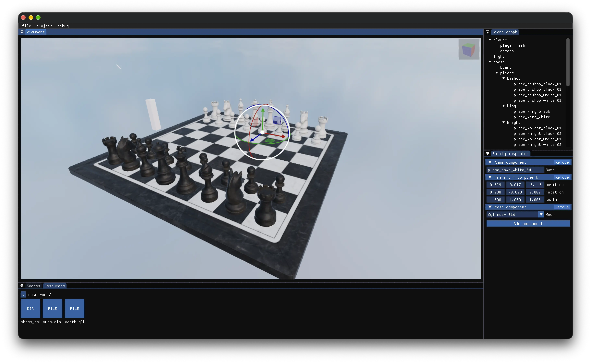
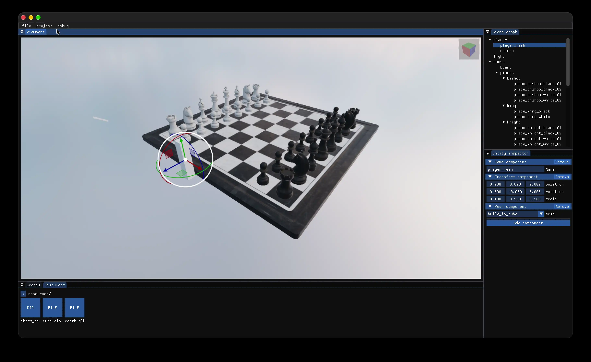
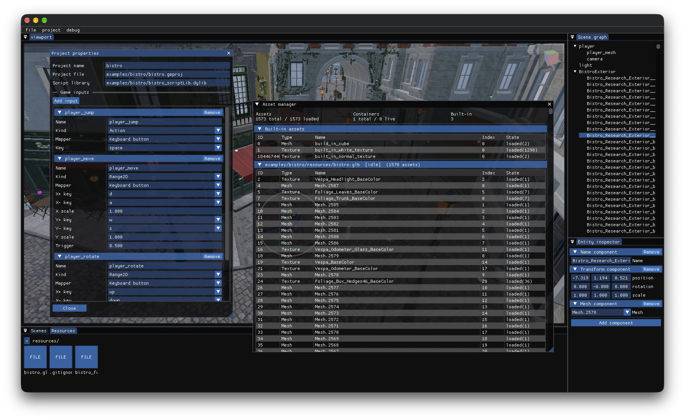

# Game-Engine

`Game-Engine` is a small C++23 game engine and editor with Metal and Vulkan backends, hot-reloadable C++ gameplay scripts, and an ECS-based scene editor. Built as a learning project.



## Build

| Platform | Metal | Vulkan |
|----------|-------|--------|
| macOS    | [](https://github.com/Thomas-Chqt/Game-Engine/actions/workflows/macos-metal.yml) | [](https://github.com/Thomas-Chqt/Game-Engine/actions/workflows/macos-vulkan.yml) |
| Windows  | N/A | [](https://github.com/Thomas-Chqt/Game-Engine/actions/workflows/windows.yml) |
| Linux    | N/A | [](https://github.com/Thomas-Chqt/Game-Engine/actions/workflows/linux.yml) |

### Requirements

- CMake 3.22 or newer
- Git and network access for dependencies fetched during configuration
- A C++23 compiler (out of the box on macOS and Windows; the Ubuntu CI uses GCC 14)
- See [`Graphics`](https://github.com/Thomas-Chqt/Graphics) for backends requirements

### Configure and Build

```sh
cmake -S . -B build -DCMAKE_BUILD_TYPE=Release -DGE_BUILD_EXAMPLES=ON
cmake --build build --config Release
```

This builds the `Game-Engine` library, the `GE-Editor` application and the examples script libraries.

### CMake Options

| Option              | Default       | Description                                                 |
| ------------------- | ------------- | ----------------------------------------------------------- |
| `GE_BUILD_METAL`    | `ON` on macOS | Enable the Metal backend                                    |
| `GE_BUILD_VULKAN`   | `ON`          | Enable the Vulkan backend                                   |
| `GE_BUILD_TESTS`    | `OFF`         | Build the test target                                       |
| `GE_BUILD_EXAMPLES` | `OFF`         | Build script libraries for all example subdirectories        |
| `GE_TRACY_ENABLE`   | `ON`          | Enable Tracy instrumentation in non-Release builds           |
| `GE_INSTALL`        | `ON`          | Enable install rules in dependencies that support them      |

## Example Projects

The repository includes `examples/project1`, a sample project that demonstrates the current engine and editor workflow. It contains:

- A chess-set scene with imported meshes, textures, lighting, and camera setup
- A set of inputs and their mappers
- A Player controller script attached to the player entity

Run the editor from the repository root so the project resource paths resolve:

```sh
./build/editor/GE-Editor examples/project1/project1.geproj
```

For multi-configuration generators, use the executable in the chosen configuration directory (for example, `build/editor/Release/GE-Editor.exe` on Windows).

`bistro` contains a larger scene. Its model is **not included**: the project references `examples/bistro/resources/bistro.glb`, which is ignored by Git. Supply the matching model before opening `examples/bistro/bistro.geproj`.

<p float="left">
  </img>
  </img>
</p>

## Libraries Used

- [`Graphics`](https://github.com/Thomas-Chqt/Graphics): rendering abstraction layer and shader toolchain
- [`GLFW`](https://github.com/glfw/glfw): windowing and input
- [`GLM`](https://github.com/g-truc/glm): math types and transforms
- [`Dear ImGui`](https://github.com/ocornut/imgui): docking editor UI via `GraphicsImGui`
- [`ImGuizmo`](https://github.com/CedricGuillemet/ImGuizmo): transform gizmos and camera orientation widget
- [`stb_image`](https://github.com/Thomas-Chqt/stb_image): image loading
- [`fastgltf`](https://github.com/spnda/fastgltf): glTF/GLB loading
- [`Tracy`](https://github.com/wolfpld/tracy): CPU and GPU profiling
- [`yaml-cpp`](https://github.com/jbeder/yaml-cpp): editor project and scene YAML serialization
- [`dlLoad`](https://github.com/Thomas-Chqt/dlLoad): dynamic library loading for scripts
- [`GoogleTest`](https://github.com/google/googletest): unit tests

## Roadmap

- [x] Metal backend on macOS and Vulkan backend
- [x] Immediate-mode frame graph with render and blit passes, buffer uploads, and asynchronous GPU readback
- [x] Metallic-roughness PBR materials with base-color, normal, metallic-roughness, and emissive textures
- [x] HDR environment lighting, skybox rendering, and ACES tone mapping
- [x] Entity Component System and scene hierarchy
- [x] ImGui editor with viewport, scene graph, inspector, project properties, and resource panels
- [x] Viewport entity picking, translation and rotation gizmos, and camera orientation widget
- [x] Runtime game mode inside the editor
- [x] YAML project, scene, input, and component serialization
- [x] Hot-reloadable gameplay scripts written in C++
- [x] Input system
- [x] glTF/GLB mesh, material, texture, and scene hierarchy import with `fastgltf`
- [x] Profiling with Tracy
- [ ] Material editing with reusable `.gemat` files
- [ ] Animation import, playback, and blending
- [ ] Editor transactions for undo/redo (Ctrl-Z)
- [ ] Shadows
- [ ] Physics using Jolt
- [ ] Standalone project export
